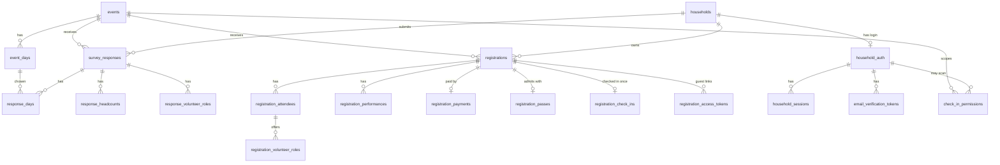

# Data Model

Source of truth: `src/db/schema/index.js` (Drizzle) and `drizzle/*.sql`. Runs unchanged on PostgreSQL 18 (`postgres:18-alpine` on the NAS) and PGlite. All timestamps are `timestamptz` (UTC); emails are `citext`; phones are E.164 (`^\+[1-9][0-9]{7,14}$`). Respondent data is soft-deleted (`deleted_at`); every change writes `change_history`.

## Entity relationships

## Tables

| Table | Key | Notable columns and constraints |
|---|---|---|
| `households` | `id` uuid | `email` citext unique; `name`; `mobile_e164`; `whatsapp_e164` requires `whatsapp_consent_at` (both set or both null); `deleted_at`, `anonymized_at` |
| `household_auth` | `household_id` (FK) | `password_hash` and/or `google_sub` (unique); at least one required; `email_verified_at` |
| `household_sessions` | `id` | `token_hash` unique (only the hash is stored); `expires_at > created_at`; `revoked_at` |
| `email_verification_tokens` | `id` | `token_hash` unique; `expires_at`; `consumed_at` |
| `events` | `id` | `slug` unique `[a-z0-9-]+`; `timezone`; `survey_opens_at < survey_closes_at`; `config_snapshot` jsonb + `config_hash` (from `config/events/*.yaml`) |
| `event_days` | `id` | unique (`event_id`, `day_date`); `label`; `sort` |
| `change_history` | bigint identity | `entity_type`, `entity_id`, `action` in create/update/delete/restore/anonymize, `snapshot` jsonb, `actor`; index (`entity_type`, `entity_id`, `created_at`) |
| `survey_responses` | `id` | unique active (`event_id`, `household_id`) where `deleted_at` is null; `food_code`, `cultural_code`, `contribution_code`; `comments` max 2000; `consent_at`; `edit_token_hash` unique |
| `response_days` | (`response_id`, `event_day_id`) | `likelihood` in definitely / likely / maybe |
| `response_headcounts` | (`response_id`, `band_code`) | `count` 0 to 100 |
| `response_volunteer_roles` | (`response_id`, `role_code`) | role codes come from the event config |
| `registrations` | `id` | unique active (`event_id`, `household_id`) where `deleted_at` is null; contact name, email, mobile (required), optional WhatsApp with consent; `status` in payment_pending / confirmed / cancelled; `total_cents >= 0` |
| `registration_attendees` | `id` | name 1 to 150 chars; `age_band` in 11_plus / 5_to_10 / under_5; `fee_cents >= 0`; `willing_to_volunteer` |
| `registration_performances` | `id` | title 1 to 150; `participant_count >= 1`; duration limit by participants (1: 1 to 4 min, 2 to 4: 1 to 5 min, 5+: 1 to 7 min); compere intro 1 to 500 chars |
| `registration_volunteer_roles` | (`attendee_id`, `role_code`) | role in culturals, food_serving_setup, stage_setup, compere_hosting, decoration, registration_desk, photography, cleanup, music_dj |
| `registration_payments` | `id` | one per registration; `status` pending / confirmed; confirmed requires `confirmed_by` and `confirmed_at`; Zelle `payer_name`, `zelle_reference`, `declared_at` |
| `registration_access_tokens` | `id` | guest access link; `token_hash` unique; `expires_at`; `revoked_at` |
| `registration_passes` | `id` | one per registration; `token_hash` unique; token stored AES-GCM encrypted (`encrypted_token`, `encryption_iv`, `auth_tag`, `key_version`); `revoked_at` |
| `registration_check_ins` | `id` | `registration_id` unique (one check-in per registration); `operator_household_id`; index (`event_id`, `checked_in_at`) |
| `check_in_permissions` | `id` | unique active (`event_id`, `household_id`) where `revoked_at` is null; `granted_by`, `granted_at` |

## Money
Amounts are integer cents. Fees are computed per attendee age band from the event config and snapshotted on each attendee (`fee_cents`), so later config changes do not alter existing registrations.

## Registration lifecycle
`payment_pending` -> (organizer confirms Zelle payment) -> `confirmed` (pass issued) ; any state -> `cancelled`.
